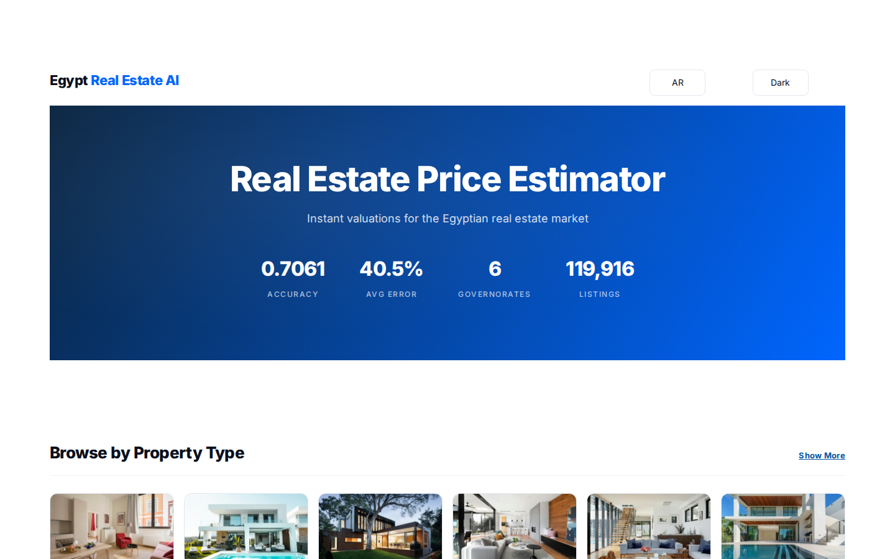
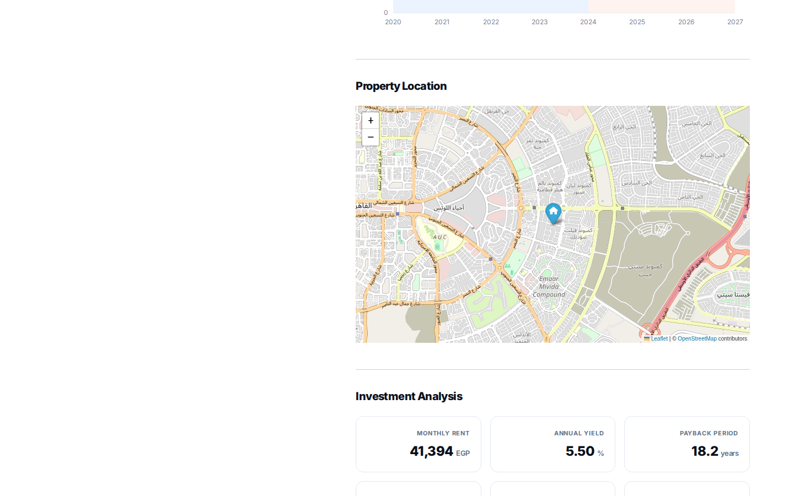
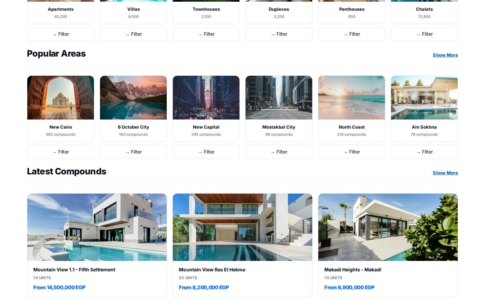
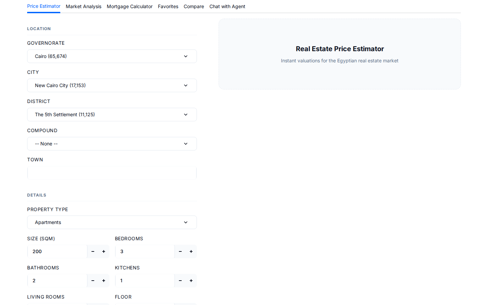
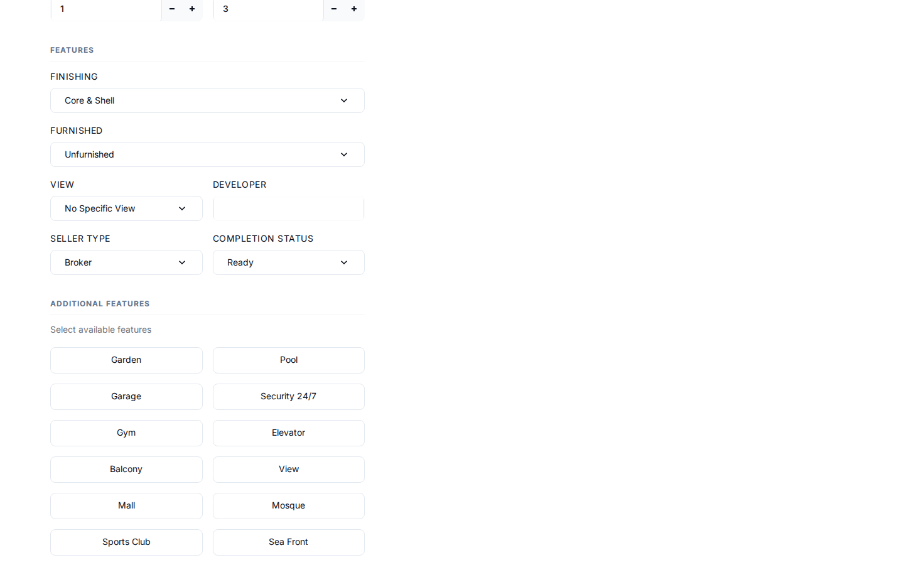
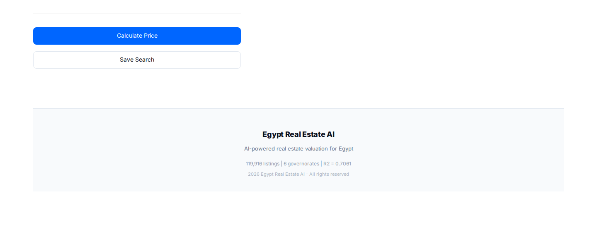
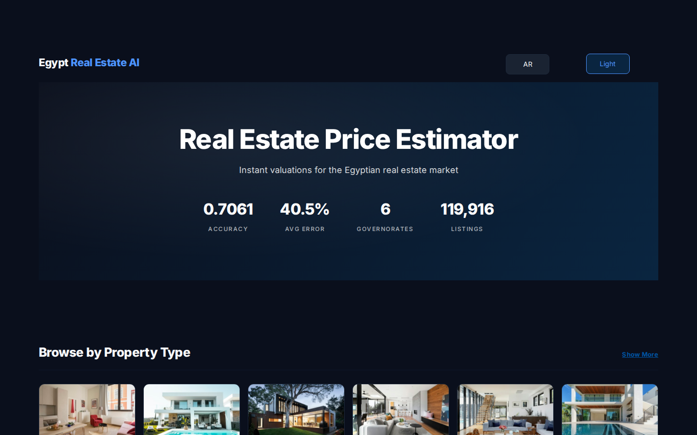
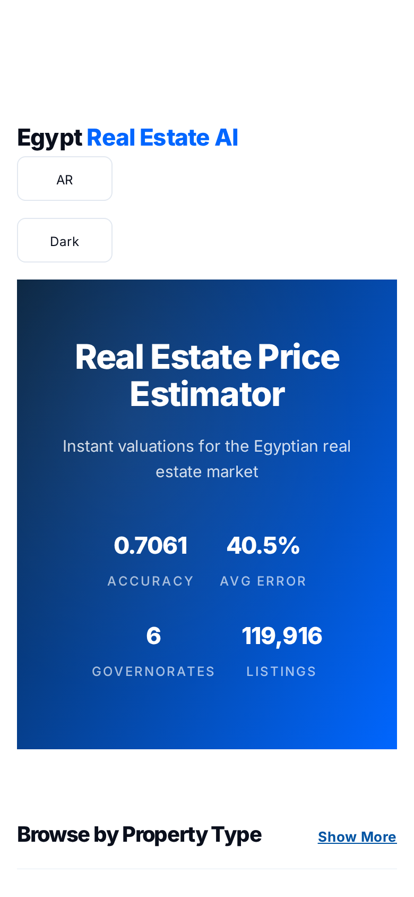
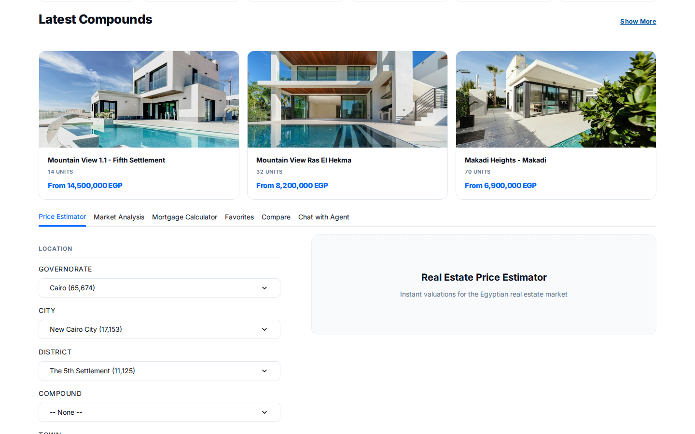
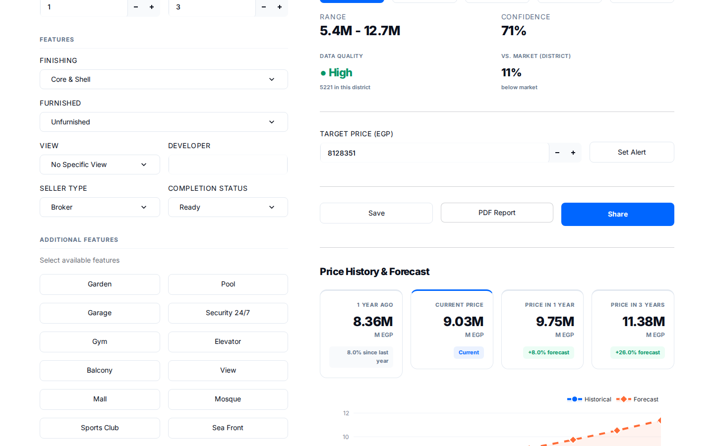

<div align="center">

# Egypt Real Estate AI

### AI-powered property valuation for the Egyptian real estate market

[](https://da.gd/AOPPkw)
[](https://da.gd/AOPPkw)
[](https://python.org)
[](https://catboost.ai)
[](https://streamlit.io)
[](LICENSE)

**Instant property price estimates backed by 119,916 real listings across Egypt**

</div>

---

## About


**Egypt Real Estate AI** is a bilingual (English / Arabic) web application that estimates property prices in the Egyptian real estate market using a gradient-boosted machine learning model.

The app combines valuation intelligence with a modern, Nawy-inspired interface — similar to Zillow's Zestimate — with full Arabic support, time-series forecasting, neighborhood insights, and interactive market analysis.

### Key Metrics

| Metric | Value |
|:---:|:---:|
| R2 Score | 0.7061 |
| MAPE (avg error) | 40.52% |
| Training Listings | 119,916 |
| Governorates | 6 (with data) |
| Districts | 573 |
| Compounds | 881 |
| Features | 32 |


## Live Demo

**Try the app now:** [**da.gd/AOPPkw**](https://da.gd/AOPPkw)

> Bilingual AI-powered property valuation for the Egyptian real estate market.

---


## Features

### AI Price Estimator
- 5-level location hierarchy (Governorate -> City -> District -> Compound -> Town)
- 32 engineered features including size, bedrooms, bathrooms, amenities, and location scores
- Confidence intervals with every prediction
- Data quality indicator showing how reliable each estimate is
- Market comparison — see if a property is above, below, or at market level

### Property Gallery
- 5 sample images per property type
- Interactive thumbnail navigation
- Auto-categorized by property type (Apartment, Villa, Duplex, etc.)

### Price History and Forecast
- 4-point timeline: 1 year ago, now, 1 year ahead, 3 years ahead
- Interactive chart with historical and forecast zones
- 8% annual growth assumption based on market trends

### Property Location
- Interactive Leaflet map with property marker
- Zoom and pan controls

### Investment Analysis (ROI)
- Monthly rent estimate
- Annual yield percentage
- Payback period
- 5-year capital growth
- 5-year future value
- Price per square meter

### Neighborhood Insights
- 5 categories: Schools, Hospitals, Transport, Shopping, Restaurants
- District-specific data for major areas
- Distance in km for each location
- Estimated data disclaimer

### Market Analysis
- 6 KPIs (listings, governorates, avg price, median)
- 3 advanced filters (governorate, property type, price range)
- 7 interactive charts including top areas, distribution, and scatter plots

### Advanced Mortgage Calculator
- Property price + down payment slider
- Monthly payment breakdown
- Pie chart (principal vs interest)
- Balance over time chart
- 12-month amortization schedule

### Compare Properties
- Select 2-4 saved favorites
- Side-by-side comparison
- Bar charts for price and size

### Favorites
- Save unlimited properties
- Export/Import JSON

### Dual Language + Dark Mode
- Full Arabic (RTL) support
- English support
- Light and Dark themes
- Nawy-inspired design

---

## Model

### Algorithm
- **CatBoost Regressor** (gradient boosting on decision trees)
- Trained on 119,916 listings from 7 data sources

### Performance

| Metric | Value |
|:---:|:---:|
| R2 Score | 0.7061 |
| MAPE | 40.52% |
| Training Set | 95,932 (80%) |
| Test Set | 23,984 (20%) |

### 32 Features

**Numeric (20):**
size, bedrooms, bathrooms, images_count, latitude, longitude, amenity_count, distance_to_cairo, distance_to_coast, is_premium, is_featured, is_luxury, is_compound, walk_score, transit_score, amenity_score, area_per_room, total_rooms, bed_bath_ratio, lat_x_lon

**Categorical (12):**
property_type, governorate, district, compound, town, completion_status, furnished, seller_type, developer_name, view, finishing_type, payment_method

---

## Data

### Coverage

| Governorate | Listings | % |
|:---:|:---:|:---:|
| Cairo | 65,674 | 54.8% |
| Giza | 30,374 | 25.3% |
| Matrouh | 10,545 | 8.8% |
| Red Sea | 6,253 | 5.2% |
| Alexandria | 4,122 | 3.4% |
| Suez | 2,948 | 2.5% |
| **Total** | **119,916** | **100%** |

---

## Tech Stack

| Layer | Technology |
|:---:|:---:|
| Frontend | Streamlit |
| Model | CatBoost |
| Data | Pandas, NumPy |
| Charts | Plotly |
| Maps | Folium |
| PDF | ReportLab |
| Styling | Custom CSS |
| Deployment | Streamlit Cloud |

---

## Run Locally

### 1. Clone the repository

```bash
git clone https://github.com/qamarsobhy7-source/Smart-House-Price-Predictor.git
```

### 2. Navigate to folder

```bash
cd Smart-House-Price-Predictor
```

### 3. Install dependencies

```bash
pip install -r requirements.txt
```

### 4. Run the app

```bash
streamlit run streamlit_app.py
```

### 5. Open in browser

Visit http://localhost:8501

---
## Screenshots

### Main View



### Estimation Result



### More Screenshots

<details>
<summary>Click to see all 10 screenshots</summary>

<br>

**Hero Section & KPIs**


**Browse by Property Type**


**Popular Areas**


**Latest Compounds**


**Dark Mode**


**Mobile View**


**Price Estimator Form**


**Investment Analysis (ROI)**


</details>

---

## Project Structure

```
Smart-House-Price-Predictor/
|-- streamlit_app.py         # Main app (2,281 lines)
|-- nawy_theme.py            # Custom CSS theme (1,328 lines)
|-- predictor.py             # Model loading & prediction
|-- requirements.txt         # Python dependencies
|-- LICENSE                  # MIT License
|-- README.md                # This file
|-- .streamlit/
|   `-- config.toml          # Streamlit configuration
|-- data/
|   |-- egypt_hierarchy.json # Geographic hierarchy
|   `-- processed/
|       `-- FINAL_DATASET_v9.csv
`-- models/
    |-- FINAL_MODEL_v9.pkl
    |-- FINAL_FEATURES_v9.pkl
    `-- FINAL_CAT_FEATURES_v9.pkl
```

---

## Design

Inspired by leading Egyptian and international real estate platforms:

- **Nawy** - Elegant minimalism
- **Aqarmap** - Arabic-first RTL support
- **Zillow** - Zestimate-style valuation
- **Property Finder** - Search-led experience

**Color Palette:**
- Primary: #0066FF (Nawy Blue)
- Accent: #FF6B35 (Warm Orange)
- Background: #FFFFFF / #F8FAFC

**Typography:**
- Arabic: **Cairo**
- English: **Inter**

---

## Roadmap

### Completed
- [x] AI price estimation with confidence intervals
- [x] Property gallery (5 sample images)
- [x] Price history & forecast (2020-2027)
- [x] Interactive map with property marker
- [x] Investment analysis (ROI, yield, payback)
- [x] Neighborhood insights (5 categories)
- [x] Market analysis (7 interactive charts)
- [x] Advanced mortgage calculator
- [x] Compare properties (2-4 side by side)
- [x] Favorites (save, export, import)
- [x] Bilingual (EN/AR) + Dark/Light mode
- [x] Interactive cards
- [x] PDF report generation

### In Progress
- [ ] Real property photos from listings
- [ ] Chat with agent (UI)
- [ ] Price alerts
- [ ] Save search
- [ ] Property details page

### Planned
- [ ] Virtual tour (3D)
- [ ] Mobile app
- [ ] Custom domain
- [ ] Analytics dashboard

---

## License

This project is licensed under the MIT License - see the LICENSE file for details.

---

## Author

**Qamar Sobhy**

- GitHub: [@qamarsobhy7-source](https://github.com/qamarsobhy7-source)
- Live App: [smart-house-price-predictor-77.streamlit.app](https://smart-house-price-predictor-77.streamlit.app)

---

<div align="center">

### If you find this project useful, please give it a star!

**Made with love in Egypt**

</div>
